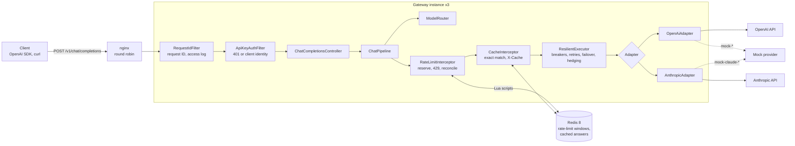

# LLM Gateway

A proxy that sits in front of LLM provider APIs. Clients call **one OpenAI-compatible
endpoint**. The gateway routes each request to the right provider (OpenAI, Anthropic,
or a local mock), translates between their formats, and relays streaming responses.

Built with Java 21 and Spring Boot 3 (Spring MVC on **virtual threads**: plain blocking
code that still handles many open streams).

> **Status: weeks 1–4 of 5.** The core proxy, streaming, two provider adapters, a mock
> provider, API-key auth, distributed token-aware rate limiting, resilience (deadlines,
> circuit breakers, retries, failover, hedging) and a response cache are done. Cost tracking
> and metrics come next (see [Roadmap](#roadmap)).

## What it does today

- `POST /v1/chat/completions`, compatible with OpenAI's API, both normal and streaming (SSE)
- Adapters for **OpenAI** and **Anthropic**: an OpenAI-format request to a `claude-*`
  model is translated to Anthropic's Messages API and back, including streams
- Config-based routing from model name to provider
- Clean failure handling: provider errors map to sensible HTTP statuses, and a stream
  that breaks halfway ends with a proper error event instead of hanging
- A **mock provider** (separate service) with configurable latency, error rate and
  mid-stream failures. All tests run against it, never against real providers
- **API-key authentication:** clients send `Authorization: Bearer <key>`; only SHA-256
  hashes of keys are stored in config
- **Distributed, token-aware rate limiting:** per-client requests-per-minute and
  tokens-per-minute over a sliding window, enforced atomically in Redis by a Lua script so
  all instances share one count. Tokens are reserved from an estimate and reconciled with
  the provider's actual usage. Rejections are `429` with `Retry-After` and OpenAI-style
  `x-ratelimit-*` headers. If Redis is unreachable, each instance falls back to its share
- **Resilience:** first-byte, total and stream deadlines on every provider call; a circuit
  breaker per provider; retries with exponential backoff and full jitter, capped by a retry
  budget; failover along an ordered list of providers per model (streams only before their
  first byte); and hedged requests for slow non-streaming calls
- **Response cache:** identical low-temperature requests from the same client are answered
  from Redis without calling a provider, also for streaming clients (replayed as SSE), with an
  `X-Cache` header and `Cache-Control: no-cache` to bypass it. A meaning-based (semantic) layer
  is built and evaluated, but off by default: the evaluation found it serves wrong answers
- Structured JSON logs with a request ID and client ID on every line
- Docker Compose with **nginx in front of three gateway instances** sharing one Redis,
  k6 tests (latency overhead, rate-limit drift), and GitHub Actions CI

## Quick start

### With Docker

```bash
docker compose up --build
```

nginx listens on `http://localhost:8080` and spreads requests over three gateway
instances, which share rate limits through Redis. The mock is on `http://localhost:8081`.
`RATE_LIMIT_BACKEND=in-memory docker compose up` switches to per-instance limits (the
baseline from the drift measurement).

### Without Docker

Requires Java 21. The Maven wrapper downloads Maven itself.

```bash
./mvnw package -DskipTests
java -jar mock-provider/target/mock-provider-0.1.0-SNAPSHOT-exec.jar
java -jar gateway/target/gateway-0.1.0-SNAPSHOT.jar --spring.profiles.active=local
```

(On Windows use `mvnw.cmd`. Run the two `java` commands in separate terminals.) Without
Docker there is one instance and no Redis, so the default in-memory rate limiter is used.

### Try it

Every request needs a gateway API key. The `local` profile (on in Docker Compose, and
with `--spring.profiles.active=local`) defines a demo client whose key is public:
`local-dev-key`. Without that profile no clients exist and every request gets a 401.

```bash
curl http://localhost:8080/v1/chat/completions -H "Authorization: Bearer local-dev-key" -H "Content-Type: application/json" -d '{"model":"mock-gpt","messages":[{"role":"user","content":"Hello"}]}'
```

Streaming:

```bash
curl -N http://localhost:8080/v1/chat/completions -H "Authorization: Bearer local-dev-key" -H "Content-Type: application/json" -d '{"model":"mock-gpt","stream":true,"messages":[{"role":"user","content":"Hello"}]}'
```

The same request through the **Anthropic adapter** (to the mock's Anthropic endpoint):

```bash
curl -N http://localhost:8080/v1/chat/completions -H "Authorization: Bearer local-dev-key" -H "Content-Type: application/json" -d '{"model":"mock-claude-3","stream":true,"messages":[{"role":"user","content":"Hello"}]}'
```

A stream that **fails halfway** (watch the final `error` event):

```bash
curl -N http://localhost:8080/v1/chat/completions -H "Authorization: Bearer local-dev-key" -H "Content-Type: application/json" -d '{"model":"mock-fail-after-3","stream":true,"messages":[{"role":"user","content":"Hello"}]}'
```

### Using real providers

Set the keys as environment variables (or copy `.env.example` to `.env`, which is
git-ignored). Keys are never stored in code or config files.

```bash
export OPENAI_API_KEY=sk-...
export ANTHROPIC_API_KEY=sk-ant-...
```

Then use real model names, e.g. `gpt-4o-mini` or `claude-sonnet-4-5`. Without a key,
those models return `503 provider_not_configured`.

## Architecture



### Request flow

1. **`RequestIdFilter`** assigns a request ID (or reuses a safe `X-Request-Id` from the
   client), puts it in the logging context, and writes one JSON access-log line at the end.
2. **`ApiKeyAuthFilter`** hashes the bearer key and looks up the client, or answers 401
   before the body is even read.
3. **`ChatCompletionsController`** validates the OpenAI-format body. `stream: true` goes
   to `StreamingChatHandler`, everything else to `ChatPipeline` directly.
4. **`ChatPipeline`** asks **`ModelRouter`** which provider serves the model (an ordered
   list of patterns, first match wins), then runs the **interceptor chain** and finally
   the **resilient executor**. The first interceptor is the **rate limiter**: it reserves
   estimated tokens (or answers 429) before the call and reconciles with actual usage after.
   The **executor** walks the model's provider list: it skips providers whose circuit breaker
   is open, retries retryable failures once with backoff (within the retry budget), fails
   over to the next provider, and hedges slow non-streaming calls. Every call runs under
   first-byte, total (or stream) deadlines and can be cancelled mid-flight.
5. **Adapters** translate to the provider's wire format and back. The OpenAI adapter
   barely translates. The Anthropic adapter moves system prompts, fills in the required
   `max_tokens`, maps stop reasons and token usage, and turns Anthropic's named stream
   events into OpenAI chunks.
6. For streams, the adapter pushes each chunk into a sink that writes it straight to
   the client. Everything runs on the request's own virtual thread.

### Key ideas

| Idea | Where | Why |
|---|---|---|
| One thread per request, blocking code | `spring.threads.virtual.enabled` | Virtual threads make blocking cheap, so the code stays simple without WebFlux |
| Adapter = protocol, provider = instance | `application.yml`, `ProviderAdapter` | One `OpenAiAdapter` serves real OpenAI *and* the mock, so tests exercise the real adapter code |
| Lazy commit for streams | `SseResponse` | Nothing is sent until the first chunk, so early failures can still be real HTTP errors |
| Interceptor chain | `pipeline/` | Where rate limiting plugs in (week 2), and caching and cost tracking will (weeks 4–5) |
| Atomic Lua script, Redis's clock | `ratelimit/*.lua` | Check-and-record can't interleave across instances, and every instance sees the same time |
| Deadlines that can abort a call | `provider/call/` | A timer cancels the Apache request through a per-call handle, so a stuck call ends on time (also how a losing hedge is cancelled) |
| Retry budget + circuit breaker | `resilience/` | During an outage, retries add a few percent instead of doubling load, and a dead provider stops being called |
| Fail over only before the first byte | `ResilientExecutor` | Until a stream reaches the client it is just a request; after that, a clean error event is the honest answer |
| Idle timeout, not total timeout | `HttpClientConfig` | A long healthy stream is fine; a stalled one is cut off (chosen by measurement) |

### How failures look to the client

| What happened | Client gets |
|---|---|
| Missing or unknown API key | `401 missing_api_key` / `invalid_api_key` |
| Over the client's request or token limit | `429 rate_limit_exceeded` with `Retry-After` |
| Estimate larger than the client's whole token limit | `429 request_too_large_for_limit`, no `Retry-After` |
| Every provider for the model has an open circuit breaker | `503 provider_circuit_open` |
| Unknown model | `404 model_not_found` |
| Invalid request body | `400 invalid_request_error` |
| Provider rejected the request (400/404/422) | same status, provider's message |
| Provider rate-limited us (429) | `429` |
| Provider down or overloaded | `502` / `503` |
| Provider timed out | `504` |
| Gateway's provider key is wrong (401/403) | `502` (the provider's message is hidden because it can contain part of the key) |
| Stream breaks **after** it started | the `200` is already sent, so a final `data: {"error": {..., "code": "stream_interrupted"}}` event, and no `[DONE]` |

All errors use OpenAI's error format, so OpenAI client libraries handle them normally.

### Project layout

```
gateway/                       the gateway (Spring Boot app)
  api/                         controller, streaming handler, error mapping, DTOs
  auth/                        API-key filter, client registry
  ratelimit/                   limiter interface, Redis + in-memory + fallback limiters, interceptor
  resilience/                  circuit breaker, retry budget, backoff, executor, hedger
  provider/call/               deadlines and cancellation of provider calls
  pipeline/                    ChatPipeline + interceptor chain
  routing/                     model → provider
  provider/                    adapter interface, shared SSE/stream code
    openai/  anthropic/        one package per adapter
  streaming/                   writing SSE to the client
  observability/               request ID filter, log field names
  resources/ratelimit/*.lua    the atomic rate-limit scripts
mock-provider/                 fake provider speaking OpenAI and Anthropic formats
nginx/nginx.conf               load balancer in front of the three instances
load-test/                     k6 tests: latency overhead, rate-limit drift
scripts/smoke-test.sh          end-to-end check of a running stack
docs/design-notes.md           every significant decision, with the alternatives rejected
```

## The mock provider

It answers in OpenAI's format at `/v1/chat/completions` and in Anthropic's at
`/v1/messages`, including their real streaming event formats and error shapes. It also
requires an API key header, so an adapter that forgets to send one fails in tests.

Random behaviour is set with environment variables:

| Variable | Default | Meaning |
|---|---|---|
| `MOCK_LATENCY_MS` | 0 (100 in Compose) | delay before the first byte |
| `MOCK_ERROR_RATE` | 0 | fraction of requests answered with HTTP 500 |
| `MOCK_MID_STREAM_FAILURE_RATE` | 0 | fraction of streams whose connection drops halfway |
| `MOCK_CHUNK_COUNT` | 5 (10 in Compose) | content chunks per response |
| `MOCK_CHUNK_DELAY_MS` | 10 | delay between chunks |

A model name can force an outcome, which keeps tests deterministic: `mock-error-503`
returns HTTP 503, and `mock-fail-after-2` streams two chunks and then drops the connection.

## Rate limiting

Each client (configured under `gateway.auth.clients`) has a **requests-per-minute** and a
**tokens-per-minute** limit over a **sliding window**:

- Before the provider call, the gateway estimates tokens (prompt characters ÷ 4, plus
  `max_tokens` or a configured default) and asks the limiter. If both limits fit, the
  request and its estimate are recorded; otherwise the client gets a 429.
- After the call, the reservation is **reconciled**: replaced by the provider's actual
  usage, refunded if the provider failed before producing anything, or kept if the outcome
  is unknown (a broken stream).
- With `backend: redis`, all windows live in Redis and a **Lua script** does the check and
  the update in one atomic step, using Redis's own clock, so every instance shares one
  count. If Redis is unreachable, each instance enforces `ceil(limit ÷ instances)` locally
  and probes Redis every 5 s.
- Every response carries `x-ratelimit-limit-requests`, `x-ratelimit-remaining-requests`,
  `x-ratelimit-limit-tokens` and `x-ratelimit-remaining-tokens` (OpenAI's names); 429s add
  `Retry-After`.

### Measured drift: shared vs per-instance (2026-11-17)

Three instances behind nginx; each client offered 5× its request limit for 3 minutes
(`load-test/rate-limit-drift.js`, run on GitHub Actions). "Max in any 60 s" is the most
admitted in any rolling minute, which is what the limit promises.

| Backend | Limit | Max in any 60 s | Drift |
|---|---|---|---|
| Redis (shared) | 300 requests/min | 300 | **+0.0%** |
| Redis (shared) | 3,000 tokens/min | 2,899 | **−3.4%** |
| In-memory (per instance) | 300 requests/min | 900 | **+200.0%** |
| In-memory (per instance) | 3,000 tokens/min | 8,697 | **+189.9%** |

The shared limiter holds exactly; per-instance limiting lets through about one full limit
per instance. Tokens err slightly on the strict side because in-flight requests hold their
estimate until reconciled. Method and caveats: design note 24.

## Resilience

- **Deadlines:** connect, idle, first byte, total (non-streaming) and a maximum stream
  duration (long, healthy streams aren't cut off by the total).
- **Circuit breaker per provider:** opens at ≥ 50% failures over the last 30 s (with at least
  20 calls), stays open 30 s, then allows 3 trial calls. Written for this project rather than
  using Resilience4j; design note 28 compares them.
- **Retries:** one retry per provider for timeouts, I/O errors, 5xx and 429, after
  `random(0, min(2 s, 100 ms × 2^retry))`. A per-provider budget keeps retries to ~10% of
  traffic. Client errors (400) are never retried or failed over.
- **Failover:** routes can list several providers in order, each with an optional model
  override. Streams fail over only before their first byte reaches the client.
- **Hedging (non-streaming):** if no answer arrives within the recent p95 latency (at least
  300 ms), the request is sent again; the first success wins and the other call is cancelled.
  At most 5% of requests are hedged, and only while the breaker is closed.

### Measured (2026-11-17)

20 requests/s, the normal Compose stack plus fault-injecting mocks (100 ms base latency),
on GitHub Actions (`load-test/resilience.js`; design note 31 has the method and caveats):

| Scenario | Success | p50 | p99 | Provider calls per request |
|---|---|---|---|---|
| Primary in full outage, failover to a backup | **100.00%** | 107 ms | 367 ms | 1.038 |
| Same outage, no failover configured | 0.00% | – | – | 0.005 (the breaker answers) |
| Provider with a 3% +2 s tail, **hedging on** | 100.00% | 106 ms | **410 ms** | 1.024 |
| Same provider, hedging off | 100.00% | 106 ms | **2,107 ms** | 1.000 |

During the outage the dead provider received 69 calls in 90 s instead of up to 3,600.

## Response cache

- **Exact layer (on):** a request is cached only if it explicitly sets `temperature` ≤ 0.3.
  The key is a hash of the client, model, system prompt, sampling settings and the normalized
  messages, so one client never receives another client's answer. Entries live in Redis with
  a TTL (1 h by default), shared by all instances.
- `X-Cache: exact | semantic | miss | bypass` on every response; `Cache-Control: no-cache`
  skips the cache. A hit still counts as a request for rate limiting, but its tokens are
  refunded.
- Only complete answers are stored (never failed calls or broken streams), and a cached
  answer serves both normal and streaming clients.
- **Semantic layer (built, off by default):** embeds single-turn prompts with a local
  `bge-small-en-v1.5` model (text-embeddings-inference) and searches Redis vector search within
  the client's scope. Turn it on with `GATEWAY_CACHE_SEMANTIC=true docker compose --profile semantic up`.

### Measured: can a similarity threshold be trusted? (2026-11-18)

200 labelled prompt pairs ([eval/](eval/README.md)): 100 paraphrases that should share an
answer, 100 look-alikes that must not. Labels drafted by Claude and reviewed by Claude at the
owner's request (not an independent human review). GitHub Actions run 44356432771:

| Threshold | Paraphrases served | Wrong answers served |
|---|---|---|
| 0.85 | 92% | 58% |
| 0.90 | 72% | 30% |
| 0.95 | 12% | 9% |
| 0.99 | 0% | 5% |

No threshold separates them: "Convert 5 miles to kilometers" and "Convert 5 kilometers to
miles" score 0.992, higher than most true paraphrases. So the semantic layer ships off.
Design note 36 has the cases it still gets wrong and what was considered instead.
Reproduce: Actions tab → *Cache threshold sweep* → *Run workflow*, or
`docker compose --profile semantic up -d embeddings` then `python eval/sweep_threshold.py`.

## Tests

```bash
./mvnw verify
```

Unit tests cover routing, error mapping, SSE parsing, the interceptor chain and the
Anthropic translation. Integration tests start the gateway **and the real mock provider**
in one JVM on random ports and talk to them over real HTTP: normal responses, streaming,
provider errors, a stream that fails midway, request IDs and the JSON access log. Real
provider keys are forced to empty in tests, so a test can never call a paid API.

Rate limiting has one shared contract test suite, `RateLimiterContractTest`, run against
both the in-memory limiter and the Redis Lua scripts. Redis-backed tests (the contract,
script storage and cleanup, a Redis paused mid-run, and **two gateway instances sharing one
Redis: 200 parallel requests against a limit of 50 admit exactly 50**) use `REDIS_URL` if
set, otherwise a Testcontainers Redis, and are skipped when neither is available.

Resilience is covered by `CircuitBreakerTest` (every state transition, with a fake clock and
100-thread races), `ResilientExecutorTest` (scripted providers: retry, failover, client errors,
open breakers, retry budget, streaming before and after the first byte), `HedgerTest` (timed
fake calls: when to hedge, cancelling the loser), `CallDeadlinesTest` (a deliberately slow local
server) and fault-injection tests that run several real mock providers (one down, one flapping,
one breaking streams, one always slow).

CI (GitHub Actions) runs all tests including the Redis ones, reports failing tests and the
Redis and resilience test counts as annotations visible without signing in, then starts the
full Compose stack (nginx, three gateways, Redis, mock) and runs `scripts/smoke-test.sh`
against it.

## Benchmark: latency added by the gateway

`load-test/gateway-overhead.js` sends identical requests directly to the mock and
through the gateway, and reports p50 and p95 for each and the difference
(see [load-test/README.md](load-test/README.md)).

### Results (measured 2026-11-16)

These were measured in week 1, before authentication and rate limiting were added to the
request path; they have not been re-measured since.

**The gateway adds about 1–2 ms at p50 and 3–5 ms at p95.**

Mock with **zero latency** (no sleeps anywhere, so only real work is measured), 10 virtual
users, 30 s per phase, phases one after another. Error rate **0.00%**. All times in ms.

| Measurement | p50 direct | p50 via gateway | **p50 overhead** | p95 direct | p95 via gateway | **p95 overhead** |
|---|---|---|---|---|---|---|
| Non-streaming, total time | 1.00 | 2.09 | **1.09** | 2.72 | 5.61 | **2.89** |
| Streaming, time to first byte | 0.55 | 2.20 | **1.65** | 3.07 | 6.08 | **3.01** |
| Streaming, total time | 1.40 | 3.68 | **2.29** | 4.61 | 9.19 | **4.58** |

**Setup:** one laptop (Intel i5-1155G7, 4 cores / 8 threads, 16 GB RAM, Windows 11), with
k6 v2.2.0, the gateway and the mock all on the same machine and talking over localhost.
JDK 21.0.2, both apps run as jars (not in Docker) with
`-Xmx192m -XX:MaxMetaspaceSize=128m -XX:ReservedCodeCacheSize=64m -Xss512k -XX:+UseSerialGC`.
The machine had under 2 GB of free memory, so the JVMs were capped.

### The 15 ms that turned out to be a bug

The first published result showed a **constant ~15 ms** of overhead. Investigating it
(design note 16) found the cause: Spring's `HttpURLConnection`-based client always sends a
request's headers and body as separate TCP writes, and `HttpURLConnection` leaves Nagle's
algorithm on. A standalone probe reproduced it outside the gateway (62.5 ms when headers
and body go in one write, 78 ms when split), and Spring 6.2 has no setting to avoid the
split. Switching to Apache HttpClient 5 (Nagle off) removed it. Same 50 ms mock setup as
the original measurement, before and after:

| Overhead, mock latency 50 ms | p50 before | p50 after | p95 before | p95 after |
|---|---|---|---|---|
| Non-streaming, total time | 15.33 | **0.57** | 18.35 | **4.53** |
| Streaming, time to first byte | 15.21 | **−2.61** | 24.10 | **1.22** |
| Streaming, total time | 16.58 | **−9.12** | 18.26 | **0.93** |

The negative "after" values are measurement noise, not a speed-up. On Windows the mock's
`Thread.sleep` calls are rounded up to the 15.6 ms timer tick, which moves each sleep by up
to ~15 ms either way (a stream has 11 sleeps). In that setup the gateway's real 1–2 ms is
smaller than the noise. That is why the headline table above uses a zero-latency mock.

**How to read the numbers:**
- Each table is the **second** of two back-to-back runs on the same JVMs. A cold JVM needs
  more than the script's 15 s warm-up (the very first run once showed a 71 ms p95 that
  disappeared on the second).
- "Overhead" is p(gateway) − p(direct), a difference of percentiles, not a per-request
  percentile. It includes the extra localhost hop, not just gateway code.
- Under load, `-Djdk.tracePinnedThreads=short` reported **zero** pinned virtual threads.

## Roadmap

1. ✅ Core proxy with streaming, OpenAI and Anthropic adapters, mock provider
2. ✅ Distributed token-aware rate limiting (Redis + Lua, 3 gateway instances)
3. ✅ Resilience: circuit breakers, retries with backoff and jitter, failover, hedged requests
4. ✅ Response cache (exact match on), semantic layer evaluated against labelled pairs and
   left off because no threshold kept wrong answers out
5. Usage and cost accounting via Kafka into PostgreSQL, metrics, load tests

## Design decisions

Every significant choice, including what was rejected and why, is in
[docs/design-notes.md](docs/design-notes.md).
