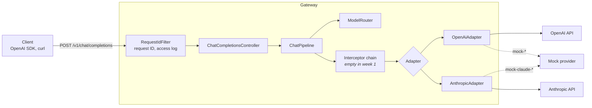

# LLM Gateway

A proxy that sits in front of LLM provider APIs. Clients call **one OpenAI-compatible
endpoint**. The gateway routes each request to the right provider (OpenAI, Anthropic,
or a local mock), translates between their formats, and relays streaming responses.

Built with Java 21 and Spring Boot 3 (Spring MVC on **virtual threads**: plain blocking
code that still handles many open streams).

> **Status: week 1 of 5.** The core proxy, streaming, two provider adapters, a mock
> provider and tests are done. Rate limiting, resilience, caching and cost tracking
> come next (see [Roadmap](#roadmap)).

## What it does today

- `POST /v1/chat/completions`, compatible with OpenAI's API, both normal and streaming (SSE)
- Adapters for **OpenAI** and **Anthropic**: an OpenAI-format request to a `claude-*`
  model is translated to Anthropic's Messages API and back, including streams
- Config-based routing from model name to provider
- Clean failure handling: provider errors map to sensible HTTP statuses, and a stream
  that breaks halfway ends with a proper error event instead of hanging
- A **mock provider** (separate service) with configurable latency, error rate and
  mid-stream failures. All tests run against it, never against real providers
- Structured JSON logs with a request ID on every line
- Docker Compose setup, a k6 overhead benchmark, and GitHub Actions CI

## Quick start

### With Docker

```bash
docker compose up --build
```

The gateway runs on `http://localhost:8080` and the mock on `http://localhost:8081`.

### Without Docker

Requires Java 21. The Maven wrapper downloads Maven itself.

```bash
./mvnw package -DskipTests
java -jar mock-provider/target/mock-provider-0.1.0-SNAPSHOT-exec.jar
java -jar gateway/target/gateway-0.1.0-SNAPSHOT.jar --spring.profiles.active=local
```

(On Windows use `mvnw.cmd`. Run the two `java` commands in separate terminals.)

### Try it

Every request needs a gateway API key. The `local` profile (on in Docker Compose, and
with `--spring.profiles.active=local`) defines a demo client whose key is public:
`local-dev-key`. Without that profile no clients exist and every request gets a 401.

```bash
curl http://localhost:8080/v1/chat/completions -H "Authorization: Bearer local-dev-key" -H "Content-Type: application/json" -d '{"model":"mock-gpt","messages":[{"role":"user","content":"Hello"}]}'
```

Streaming:

```bash
curl -N http://localhost:8080/v1/chat/completions -H "Authorization: Bearer local-dev-key" -H "Content-Type: application/json" -d '{"model":"mock-gpt","stream":true,"messages":[{"role":"user","content":"Hello"}]}'
```

The same request through the **Anthropic adapter** (to the mock's Anthropic endpoint):

```bash
curl -N http://localhost:8080/v1/chat/completions -H "Authorization: Bearer local-dev-key" -H "Content-Type: application/json" -d '{"model":"mock-claude-3","stream":true,"messages":[{"role":"user","content":"Hello"}]}'
```

A stream that **fails halfway** (watch the final `error` event):

```bash
curl -N http://localhost:8080/v1/chat/completions -H "Authorization: Bearer local-dev-key" -H "Content-Type: application/json" -d '{"model":"mock-fail-after-3","stream":true,"messages":[{"role":"user","content":"Hello"}]}'
```

### Using real providers

Set the keys as environment variables (or copy `.env.example` to `.env`, which is
git-ignored). Keys are never stored in code or config files.

```bash
export OPENAI_API_KEY=sk-...
export ANTHROPIC_API_KEY=sk-ant-...
```

Then use real model names, e.g. `gpt-4o-mini` or `claude-sonnet-4-5`. Without a key,
those models return `503 provider_not_configured`.

## Architecture



### Request flow

1. **`RequestIdFilter`** assigns a request ID (or reuses a safe `X-Request-Id` from the
   client), puts it in the logging context, and writes one JSON access-log line at the end.
2. **`ChatCompletionsController`** validates the OpenAI-format body. `stream: true` goes
   to `StreamingChatHandler`, everything else to `ChatPipeline` directly.
3. **`ChatPipeline`** asks **`ModelRouter`** which provider serves the model (an ordered
   list of patterns, first match wins), then runs the **interceptor chain** and finally
   the provider's **adapter**.
4. **Adapters** translate to the provider's wire format and back. The OpenAI adapter
   barely translates. The Anthropic adapter moves system prompts, fills in the required
   `max_tokens`, maps stop reasons and token usage, and turns Anthropic's named stream
   events into OpenAI chunks.
5. For streams, the adapter pushes each chunk into a sink that writes it straight to
   the client. Everything runs on the request's own virtual thread.

### Key ideas

| Idea | Where | Why |
|---|---|---|
| One thread per request, blocking code | `spring.threads.virtual.enabled` | Virtual threads make blocking cheap, so the code stays simple without WebFlux |
| Adapter = protocol, provider = instance | `application.yml`, `ProviderAdapter` | One `OpenAiAdapter` serves real OpenAI *and* the mock, so tests exercise the real adapter code |
| Lazy commit for streams | `SseResponse` | Nothing is sent until the first chunk, so early failures can still be real HTTP errors |
| Interceptor chain | `pipeline/` | The plug-in point for rate limiting, caching and cost tracking in later weeks |
| Idle timeout, not total timeout | `HttpClientConfig` | A long healthy stream is fine; a stalled one is cut off (chosen by measurement) |

### How failures look to the client

| What happened | Client gets |
|---|---|
| Unknown model | `404 model_not_found` |
| Invalid request body | `400 invalid_request_error` |
| Provider rejected the request (400/404/422) | same status, provider's message |
| Provider rate-limited us (429) | `429` |
| Provider down or overloaded | `502` / `503` |
| Provider timed out | `504` |
| Gateway's provider key is wrong (401/403) | `502` (the provider's message is hidden because it can contain part of the key) |
| Stream breaks **after** it started | the `200` is already sent, so a final `data: {"error": {..., "code": "stream_interrupted"}}` event, and no `[DONE]` |

All errors use OpenAI's error format, so OpenAI client libraries handle them normally.

### Project layout

```
gateway/                       the gateway (Spring Boot app)
  api/                         controller, streaming handler, error mapping, DTOs
  pipeline/                    ChatPipeline + interceptor chain
  routing/                     model → provider
  provider/                    adapter interface, shared SSE/stream code
    openai/  anthropic/        one package per adapter
  streaming/                   writing SSE to the client
  observability/               request ID filter, log field names
mock-provider/                 fake provider speaking OpenAI and Anthropic formats
load-test/                     k6 overhead benchmark
scripts/smoke-test.sh          end-to-end check of a running stack
docs/design-notes.md           every significant decision, with the alternatives rejected
```

## The mock provider

It answers in OpenAI's format at `/v1/chat/completions` and in Anthropic's at
`/v1/messages`, including their real streaming event formats and error shapes. It also
requires an API key header, so an adapter that forgets to send one fails in tests.

Random behaviour is set with environment variables:

| Variable | Default | Meaning |
|---|---|---|
| `MOCK_LATENCY_MS` | 0 (100 in Compose) | delay before the first byte |
| `MOCK_ERROR_RATE` | 0 | fraction of requests answered with HTTP 500 |
| `MOCK_MID_STREAM_FAILURE_RATE` | 0 | fraction of streams whose connection drops halfway |
| `MOCK_CHUNK_COUNT` | 5 (10 in Compose) | content chunks per response |
| `MOCK_CHUNK_DELAY_MS` | 10 | delay between chunks |

A model name can force an outcome, which keeps tests deterministic: `mock-error-503`
returns HTTP 503, and `mock-fail-after-2` streams two chunks and then drops the connection.

## Tests

```bash
./mvnw verify
```

Unit tests cover routing, error mapping, SSE parsing, the interceptor chain and the
Anthropic translation. Integration tests start the gateway **and the real mock provider**
in one JVM on random ports and talk to them over real HTTP: normal responses, streaming,
provider errors, a stream that fails midway, request IDs and the JSON access log. Real
provider keys are forced to empty in tests, so a test can never call a paid API.

CI (GitHub Actions) runs the tests, then builds the Docker images, starts the stack
with Compose and runs `scripts/smoke-test.sh` against it.

## Benchmark: latency added by the gateway

`load-test/gateway-overhead.js` sends identical requests directly to the mock and
through the gateway, and reports p50 and p95 for each and the difference
(see [load-test/README.md](load-test/README.md)).

### Results (measured 2026-11-16)

**The gateway adds about 1–2 ms at p50 and 3–5 ms at p95.**

Mock with **zero latency** (no sleeps anywhere, so only real work is measured), 10 virtual
users, 30 s per phase, phases one after another. Error rate **0.00%**. All times in ms.

| Measurement | p50 direct | p50 via gateway | **p50 overhead** | p95 direct | p95 via gateway | **p95 overhead** |
|---|---|---|---|---|---|---|
| Non-streaming, total time | 1.00 | 2.09 | **1.09** | 2.72 | 5.61 | **2.89** |
| Streaming, time to first byte | 0.55 | 2.20 | **1.65** | 3.07 | 6.08 | **3.01** |
| Streaming, total time | 1.40 | 3.68 | **2.29** | 4.61 | 9.19 | **4.58** |

**Setup:** one laptop (Intel i5-1155G7, 4 cores / 8 threads, 16 GB RAM, Windows 11), with
k6 v2.2.0, the gateway and the mock all on the same machine and talking over localhost.
JDK 21.0.2, both apps run as jars (not in Docker) with
`-Xmx192m -XX:MaxMetaspaceSize=128m -XX:ReservedCodeCacheSize=64m -Xss512k -XX:+UseSerialGC`.
The machine had under 2 GB of free memory, so the JVMs were capped.

### The 15 ms that turned out to be a bug

The first published result showed a **constant ~15 ms** of overhead. Investigating it
(design note 16) found the cause: Spring's `HttpURLConnection`-based client always sends a
request's headers and body as separate TCP writes, and `HttpURLConnection` leaves Nagle's
algorithm on. A standalone probe reproduced it outside the gateway (62.5 ms when headers
and body go in one write, 78 ms when split), and Spring 6.2 has no setting to avoid the
split. Switching to Apache HttpClient 5 (Nagle off) removed it. Same 50 ms mock setup as
the original measurement, before and after:

| Overhead, mock latency 50 ms | p50 before | p50 after | p95 before | p95 after |
|---|---|---|---|---|
| Non-streaming, total time | 15.33 | **0.57** | 18.35 | **4.53** |
| Streaming, time to first byte | 15.21 | **−2.61** | 24.10 | **1.22** |
| Streaming, total time | 16.58 | **−9.12** | 18.26 | **0.93** |

The negative "after" values are measurement noise, not a speed-up. On Windows the mock's
`Thread.sleep` calls are rounded up to the 15.6 ms timer tick, which moves each sleep by up
to ~15 ms either way (a stream has 11 sleeps). In that setup the gateway's real 1–2 ms is
smaller than the noise. That is why the headline table above uses a zero-latency mock.

**How to read the numbers:**
- Each table is the **second** of two back-to-back runs on the same JVMs. A cold JVM needs
  more than the script's 15 s warm-up (the very first run once showed a 71 ms p95 that
  disappeared on the second).
- "Overhead" is p(gateway) − p(direct), a difference of percentiles, not a per-request
  percentile. It includes the extra localhost hop, not just gateway code.
- Under load, `-Djdk.tracePinnedThreads=short` reported **zero** pinned virtual threads.

## Roadmap

1. ✅ Core proxy with streaming, OpenAI and Anthropic adapters, mock provider
2. Distributed token-aware rate limiting (Redis + Lua, 3 gateway instances)
3. Resilience: circuit breakers, retries with backoff and jitter, failover, hedged requests
4. Semantic cache, with an evaluation set measuring hit rate vs false hits
5. Usage and cost accounting via Kafka into PostgreSQL, metrics, load tests

## Design decisions

Every significant choice, including what was rejected and why, is in
[docs/design-notes.md](docs/design-notes.md).
