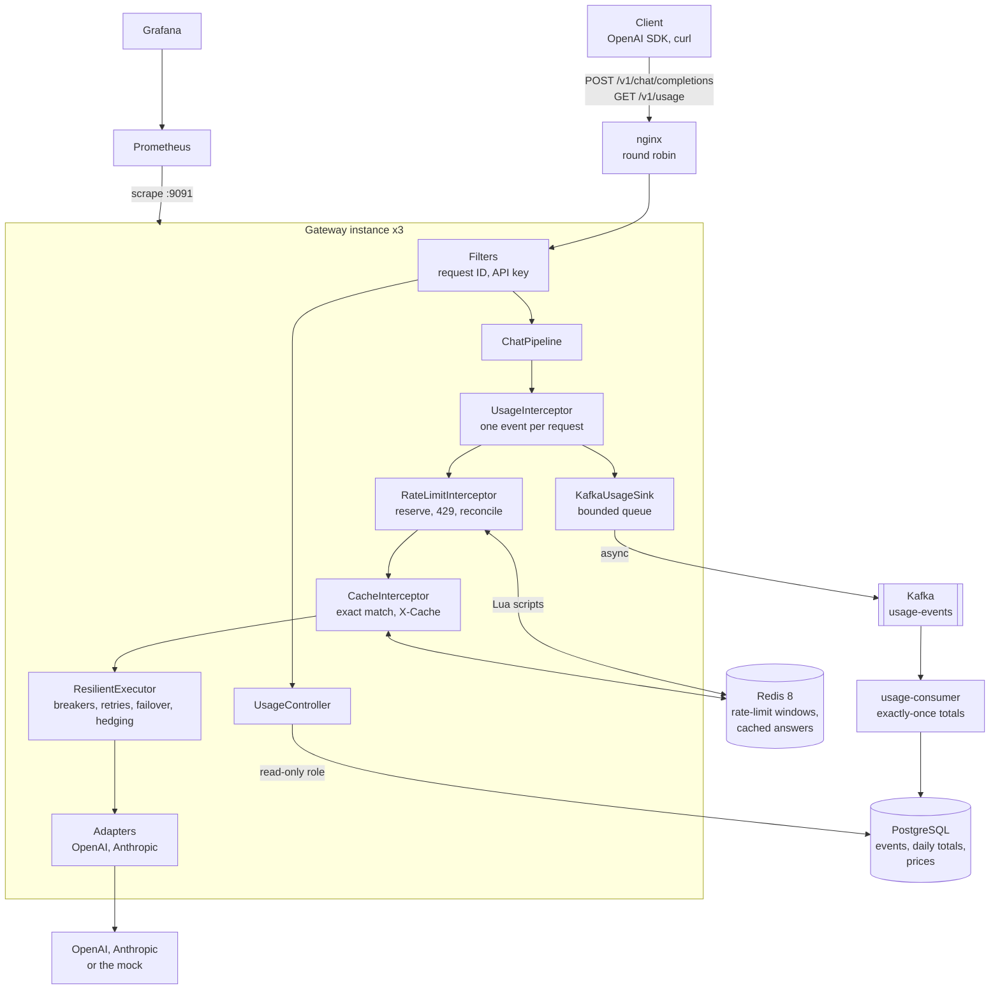
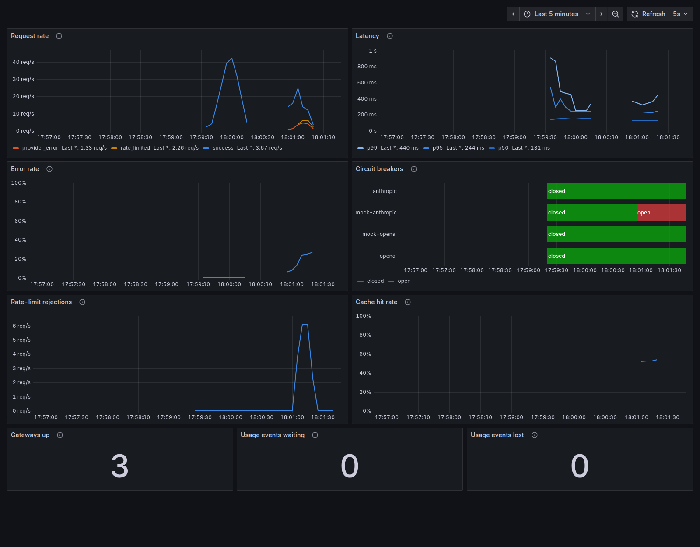

<div align="center">

# 🚦 LLM Gateway

**One OpenAI‑compatible endpoint in front of every LLM provider, with routing, streaming, token‑aware rate limiting, production‑grade resilience, a response cache, exactly‑once usage and cost accounting, and metrics.**


</div>

---

A proxy that sits in front of LLM provider APIs. Clients call **one OpenAI-compatible
endpoint**. The gateway routes each request to the right provider (OpenAI, Anthropic,
or a local mock), translates between their formats, and relays streaming responses.

Built with Java 21 and Spring Boot 3 (Spring MVC on **virtual threads**: plain blocking
code that still handles many open streams).

> **Status: all five weeks done.** The core proxy, streaming, two provider adapters, a mock
> provider, API-key auth, distributed token-aware rate limiting, resilience (deadlines,
> circuit breakers, retries, failover, hedging), a response cache, usage and cost accounting
> through Kafka into PostgreSQL, and Prometheus metrics with a Grafana dashboard.
> **Measured:** 1,000 requests per second through the full stack with every feature on, no
> request failed and no usage event lost ([Benchmarks](#benchmarks)).

## What it does today

- `POST /v1/chat/completions`, compatible with OpenAI's API, both normal and streaming (SSE)
- Adapters for **OpenAI** and **Anthropic**: an OpenAI-format request to a `claude-*`
  model is translated to Anthropic's Messages API and back, including streams
- Config-based routing from model name to provider
- Clean failure handling: provider errors map to sensible HTTP statuses, and a stream
  that breaks halfway ends with a proper error event instead of hanging
- A **mock provider** (separate service) with configurable latency, error rate and
  mid-stream failures. All tests run against it, never against real providers
- **API-key authentication:** clients send `Authorization: Bearer <key>`; only SHA-256
  hashes of keys are stored in config
- **Distributed, token-aware rate limiting:** per-client requests-per-minute and
  tokens-per-minute over a sliding window, enforced atomically in Redis by a Lua script so
  all instances share one count. Tokens are reserved from an estimate and reconciled with
  the provider's actual usage. Rejections are `429` with `Retry-After` and OpenAI-style
  `x-ratelimit-*` headers. If Redis is unreachable, each instance falls back to its share
- **Resilience:** first-byte, total and stream deadlines on every provider call; a circuit
  breaker per provider; retries with exponential backoff and full jitter, capped by a retry
  budget; failover along an ordered list of providers per model (streams only before their
  first byte); and hedged requests for slow non-streaming calls
- **Response cache:** identical low-temperature requests from the same client are answered
  from Redis without calling a provider, also for streaming clients (replayed as SSE), with an
  `X-Cache` header and `Cache-Control: no-cache` to bypass it. A meaning-based (semantic) layer
  is built and evaluated, but off by default: the evaluation found it serves wrong answers
- **Usage and cost accounting:** one usage event per request (tokens, latency, cache outcome,
  status) goes to **Kafka** without ever slowing or failing the request; a separate consumer
  records it in **PostgreSQL exactly once** (unique event ID, offsets committed after the
  database), prices it from a price table as of when it happened, and keeps daily totals per
  client. `GET /v1/usage` returns the calling key's usage and cost
- **Metrics:** Prometheus metrics on a separate port, and a provisioned **Grafana dashboard**
  with request rate, latency percentiles, error rate, circuit-breaker state, rate-limit
  rejections, cache hit rate and lost usage events
- Structured JSON logs with a request ID and client ID on every line
- Docker Compose with **nginx in front of three gateway instances** sharing Redis, plus Kafka,
  PostgreSQL, the usage consumer, Prometheus and Grafana; k6 tests (latency overhead,
  rate-limit drift, resilience, full stack); GitHub Actions CI

## 🧰 Tech stack

| Layer | Technology |
|------|-----------|
| Language / runtime | Java 21 with virtual threads (Spring MVC: blocking code, many open streams) |
| Framework | Spring Boot 3: Web, Validation, Data Redis, Actuator, Spring Kafka, JDBC + Flyway. Multi‑module Maven build (`gateway`, `usage-consumer`, `mock-provider`) |
| HTTP client | Apache HttpClient 5, with per‑call cancellation handles for deadlines and hedging |
| Rate limiting | Redis sliding windows updated atomically by Lua scripts, with a local fallback when Redis is down |
| Resilience | Per‑provider circuit breakers, retry budget, exponential backoff with full jitter, ordered failover, hedged requests |
| Caching | Exact‑match response cache in Redis with TTL; semantic layer (local text‑embeddings‑inference + Redis vector search) evaluated on labelled pairs and off by default |
| Streaming | Server‑Sent Events relay with format translation (OpenAI ⇄ Anthropic) |
| Usage accounting | Kafka (bounded in‑memory buffer in each gateway), an idempotent consumer, PostgreSQL with exact decimal costs |
| Observability | Micrometer → Prometheus (histograms, not per‑instance percentiles), provisioned Grafana dashboard, JSON logs |
| Infra | Docker Compose: nginx → 3 gateway instances → Redis; Kafka → usage consumer → PostgreSQL; Prometheus, Grafana; a mock provider (and an embedding service under `--profile semantic`) |
| Testing | JUnit 5, Spring Boot Test, Testcontainers (Redis, Kafka, PostgreSQL), k6 (overhead, rate‑limit drift, resilience, full stack) with Python report scripts |
| CI | GitHub Actions |

## Quick start

### With Docker

```bash
docker compose up --build
```

nginx listens on `http://localhost:8080` and spreads requests over three gateway
instances, which share rate limits and the cache through Redis. The mock is on
`http://localhost:8081`, the Grafana dashboard on `http://localhost:3000` (Prometheus:
`http://localhost:9090`).
`RATE_LIMIT_BACKEND=in-memory docker compose up` switches to per-instance limits (the
baseline from the drift measurement).

### Without Docker

Requires Java 21. The Maven wrapper downloads Maven itself.

```bash
./mvnw package -DskipTests
java -jar mock-provider/target/mock-provider-0.1.0-SNAPSHOT-exec.jar
java -jar gateway/target/gateway-0.1.0-SNAPSHOT.jar --spring.profiles.active=local
```

(On Windows use `mvnw.cmd`. Run the two `java` commands in separate terminals.) Without
Docker there is one instance and no Redis, so the default in-memory rate limiter is used,
usage events only go to the log, and `GET /v1/usage` answers 503 (no database).

### Try it

Every request needs a gateway API key. The `local` profile (on in Docker Compose, and
with `--spring.profiles.active=local`) defines a demo client whose key is public:
`local-dev-key`. Without that profile no clients exist and every request gets a 401.

```bash
curl http://localhost:8080/v1/chat/completions -H "Authorization: Bearer local-dev-key" -H "Content-Type: application/json" -d '{"model":"mock-gpt","messages":[{"role":"user","content":"Hello"}]}'
```

Streaming:

```bash
curl -N http://localhost:8080/v1/chat/completions -H "Authorization: Bearer local-dev-key" -H "Content-Type: application/json" -d '{"model":"mock-gpt","stream":true,"messages":[{"role":"user","content":"Hello"}]}'
```

The same request through the **Anthropic adapter** (to the mock's Anthropic endpoint):

```bash
curl -N http://localhost:8080/v1/chat/completions -H "Authorization: Bearer local-dev-key" -H "Content-Type: application/json" -d '{"model":"mock-claude-3","stream":true,"messages":[{"role":"user","content":"Hello"}]}'
```

A stream that **fails halfway** (watch the final `error` event):

```bash
curl -N http://localhost:8080/v1/chat/completions -H "Authorization: Bearer local-dev-key" -H "Content-Type: application/json" -d '{"model":"mock-fail-after-3","stream":true,"messages":[{"role":"user","content":"Hello"}]}'
```

Your usage and cost so far (UTC days; `from` and `to` are optional, e.g. `?from=2026-11-01`):

```bash
curl http://localhost:8080/v1/usage -H "Authorization: Bearer local-dev-key"
```

### Using real providers

Set the keys as environment variables (or copy `.env.example` to `.env`, which is
git-ignored). Keys are never stored in code or config files.

```bash
export OPENAI_API_KEY=sk-...
export ANTHROPIC_API_KEY=sk-ant-...
```

Then use real model names, e.g. `gpt-4o-mini` or `claude-sonnet-4-5`. Without a key,
those models return `503 provider_not_configured`.

## Architecture



### Request flow

1. **`RequestIdFilter`** assigns a request ID (or reuses a safe `X-Request-Id` from the
   client), puts it in the logging context, and writes one JSON access-log line at the end.
2. **`ApiKeyAuthFilter`** hashes the bearer key and looks up the client, or answers 401
   before the body is even read.
3. **`ChatCompletionsController`** validates the OpenAI-format body. `stream: true` goes
   to `StreamingChatHandler`, everything else to `ChatPipeline` directly.
4. **`ChatPipeline`** asks **`ModelRouter`** which provider serves the model (an ordered
   list of patterns, first match wins), then runs the **interceptor chain** and finally
   the **resilient executor**. The first interceptor is the **rate limiter**: it reserves
   estimated tokens (or answers 429) before the call and reconciles with actual usage after.
   The **executor** walks the model's provider list: it skips providers whose circuit breaker
   is open, retries retryable failures once with backoff (within the retry budget), fails
   over to the next provider, and hedges slow non-streaming calls. Every call runs under
   first-byte, total (or stream) deadlines and can be cancelled mid-flight. Before all of them,
   the **usage interceptor** times the request and, when it ends however it ends, records one
   usage event and the request metrics.
5. **Adapters** translate to the provider's wire format and back. The OpenAI adapter
   barely translates. The Anthropic adapter moves system prompts, fills in the required
   `max_tokens`, maps stop reasons and token usage, and turns Anthropic's named stream
   events into OpenAI chunks.
6. For streams, the adapter pushes each chunk into a sink that writes it straight to
   the client. Everything runs on the request's own virtual thread.
7. The usage event goes into a bounded in-memory queue; a background thread sends it to
   **Kafka**, so a slow or missing Kafka never touches a request. The **usage consumer**
   (a separate service) records it in **PostgreSQL** and adds it to the client's daily
   totals, in one transaction, only if its event ID is new.

### Key ideas

| Idea | Where | Why |
|---|---|---|
| One thread per request, blocking code | `spring.threads.virtual.enabled` | Virtual threads make blocking cheap, so the code stays simple without WebFlux |
| Adapter = protocol, provider = instance | `application.yml`, `ProviderAdapter` | One `OpenAiAdapter` serves real OpenAI *and* the mock, so tests exercise the real adapter code |
| Lazy commit for streams | `SseResponse` | Nothing is sent until the first chunk, so early failures can still be real HTTP errors |
| Interceptor chain | `pipeline/` | Usage accounting, rate limiting and caching are each one interceptor, in a fixed order |
| Atomic Lua script, Redis's clock | `ratelimit/*.lua` | Check-and-record can't interleave across instances, and every instance sees the same time |
| Deadlines that can abort a call | `provider/call/` | A timer cancels the Apache request through a per-call handle, so a stuck call ends on time (also how a losing hedge is cancelled) |
| Retry budget + circuit breaker | `resilience/` | During an outage, retries add a few percent instead of doubling load, and a dead provider stops being called |
| Fail over only before the first byte | `ResilientExecutor` | Until a stream reaches the client it is just a request; after that, a clean error event is the honest answer |
| Idle timeout, not total timeout | `HttpClientConfig` | A long healthy stream is fine; a stalled one is cut off (chosen by measurement) |
| Usage never blocks a request | `KafkaUsageSink` | A request only offers its event to a queue; Kafka being down costs memory, then counted losses, never latency |
| At-least-once delivery, exactly-once totals | `UsageStore` | Redelivery is allowed anywhere; the event ID as primary key makes the second copy a no-op |
| One request metric, from the usage event | `RequestMetrics` | Dashboard and bill can't disagree; histograms add up across instances, percentiles don't |

### How failures look to the client

| What happened | Client gets |
|---|---|
| Missing or unknown API key | `401 missing_api_key` / `invalid_api_key` |
| Over the client's request or token limit | `429 rate_limit_exceeded` with `Retry-After` |
| Estimate larger than the client's whole token limit | `429 request_too_large_for_limit`, no `Retry-After` |
| Every provider for the model has an open circuit breaker | `503 provider_circuit_open` |
| Unknown model | `404 model_not_found` |
| Invalid request body | `400 invalid_request_error` |
| Provider rejected the request (400/404/422) | same status, provider's message |
| Provider rate-limited us (429) | `429` |
| Provider down or overloaded | `502` / `503` |
| Provider timed out | `504` |
| Gateway's provider key is wrong (401/403) | `502` (the provider's message is hidden because it can contain part of the key) |
| `GET /v1/usage` with a bad date range | `400 invalid_request` |
| `GET /v1/usage` while its database is down | `503 usage_unavailable` (chat is unaffected) |
| Stream breaks **after** it started | the `200` is already sent, so a final `data: {"error": {..., "code": "stream_interrupted"}}` event, and no `[DONE]` |

All errors use OpenAI's error format, so OpenAI client libraries handle them normally.

### Project layout

```
gateway/                       the gateway (Spring Boot app)
  api/                         controller, streaming handler, error mapping, DTOs
  auth/                        API-key filter, client registry
  ratelimit/                   limiter interface, Redis + in-memory + fallback limiters, interceptor
  resilience/                  circuit breaker, retry budget, backoff, executor, hedger
  provider/call/               deadlines and cancellation of provider calls
  pipeline/                    ChatPipeline + interceptor chain
  routing/                     model → provider
  provider/                    adapter interface, shared SSE/stream code
    openai/  anthropic/        one package per adapter
  streaming/                   writing SSE to the client
  cache/                       exact and semantic cache, stores, embeddings
  usage/                       usage interceptor, Kafka sink; report/ for GET /v1/usage
  observability/               request ID filter, log field names, request metrics
  resources/ratelimit/*.lua    the atomic rate-limit scripts
usage-consumer/                Kafka → PostgreSQL, exactly once (Flyway migrations in db/)
mock-provider/                 fake provider speaking OpenAI and Anthropic formats
contracts/usage-event.json     the event format both services are tested against
nginx/nginx.conf               load balancer in front of the three instances
deploy/                        PostgreSQL role, Prometheus config, Grafana dashboard
load-test/                     k6 tests: latency overhead, rate-limit drift, resilience, full stack
scripts/                       smoke test, usage check, reconciliation, metrics check
eval/                          semantic-cache evaluation (labelled pairs, threshold sweep)
results/                       measured outputs (cache threshold, full-stack load test)
docs/design-notes.md           every significant decision, with the alternatives rejected
```

## The mock provider

It answers in OpenAI's format at `/v1/chat/completions` and in Anthropic's at
`/v1/messages`, including their real streaming event formats and error shapes. It also
requires an API key header, so an adapter that forgets to send one fails in tests.

Random behaviour is set with environment variables:

| Variable | Default | Meaning |
|---|---|---|
| `MOCK_LATENCY_MS` | 0 (100 in Compose) | delay before the first byte |
| `MOCK_ERROR_RATE` | 0 | fraction of requests answered with HTTP 500 |
| `MOCK_MID_STREAM_FAILURE_RATE` | 0 | fraction of streams whose connection drops halfway |
| `MOCK_CHUNK_COUNT` | 5 (10 in Compose) | content chunks per response |
| `MOCK_CHUNK_DELAY_MS` | 10 | delay between chunks |

A model name can force an outcome, which keeps tests deterministic: `mock-error-503`
returns HTTP 503, and `mock-fail-after-2` streams two chunks and then drops the connection.

## Rate limiting

Each client (configured under `gateway.auth.clients`) has a **requests-per-minute** and a
**tokens-per-minute** limit over a **sliding window**:

- Before the provider call, the gateway estimates tokens (prompt characters ÷ 4, plus
  `max_tokens` or a configured default) and asks the limiter. If both limits fit, the
  request and its estimate are recorded; otherwise the client gets a 429.
- After the call, the reservation is **reconciled**: replaced by the provider's actual
  usage, refunded if the provider failed before producing anything, or kept if the outcome
  is unknown (a broken stream).
- With `backend: redis`, all windows live in Redis and a **Lua script** does the check and
  the update in one atomic step, using Redis's own clock, so every instance shares one
  count. If Redis is unreachable, each instance enforces `ceil(limit ÷ instances)` locally
  and probes Redis every 5 s.
- Every response carries `x-ratelimit-limit-requests`, `x-ratelimit-remaining-requests`,
  `x-ratelimit-limit-tokens` and `x-ratelimit-remaining-tokens` (OpenAI's names); 429s add
  `Retry-After`.

### Measured drift: shared vs per-instance (2026-11-17)

Three instances behind nginx; each client offered 5× its request limit for 3 minutes
(`load-test/rate-limit-drift.js`, run on GitHub Actions). "Max in any 60 s" is the most
admitted in any rolling minute, which is what the limit promises.

| Backend | Limit | Max in any 60 s | Drift |
|---|---|---|---|
| Redis (shared) | 300 requests/min | 300 | **+0.0%** |
| Redis (shared) | 3,000 tokens/min | 2,899 | **−3.4%** |
| In-memory (per instance) | 300 requests/min | 900 | **+200.0%** |
| In-memory (per instance) | 3,000 tokens/min | 8,697 | **+189.9%** |

The shared limiter holds exactly; per-instance limiting lets through about one full limit
per instance. Tokens err slightly on the strict side because in-flight requests hold their
estimate until reconciled. Method and caveats: design note 24.

## Resilience

- **Deadlines:** connect, idle, first byte, total (non-streaming) and a maximum stream
  duration (long, healthy streams aren't cut off by the total).
- **Circuit breaker per provider:** opens at ≥ 50% failures over the last 30 s (with at least
  20 calls), stays open 30 s, then allows 3 trial calls. Written for this project rather than
  using Resilience4j; design note 28 compares them.
- **Retries:** one retry per provider for timeouts, I/O errors, 5xx and 429, after
  `random(0, min(2 s, 100 ms × 2^retry))`. A per-provider budget keeps retries to ~10% of
  traffic. Client errors (400) are never retried or failed over.
- **Failover:** routes can list several providers in order, each with an optional model
  override. Streams fail over only before their first byte reaches the client.
- **Hedging (non-streaming):** if no answer arrives within the recent p95 latency (at least
  300 ms), the request is sent again; the first success wins and the other call is cancelled.
  At most 5% of requests are hedged, and only while the breaker is closed.

### Measured (2026-11-17)

20 requests/s, the normal Compose stack plus fault-injecting mocks (100 ms base latency),
on GitHub Actions (`load-test/resilience.js`; design note 31 has the method and caveats):

| Scenario | Success | p50 | p99 | Provider calls per request |
|---|---|---|---|---|
| Primary in full outage, failover to a backup | **100.00%** | 107 ms | 367 ms | 1.038 |
| Same outage, no failover configured | 0.00% | – | – | 0.005 (the breaker answers) |
| Provider with a 3% +2 s tail, **hedging on** | 100.00% | 106 ms | **410 ms** | 1.024 |
| Same provider, hedging off | 100.00% | 106 ms | **2,107 ms** | 1.000 |

During the outage the dead provider received 69 calls in 90 s instead of up to 3,600.

## Response cache

- **Exact layer (on):** a request is cached only if it explicitly sets `temperature` ≤ 0.3.
  The key is a hash of the client, model, system prompt, sampling settings and the normalized
  messages, so one client never receives another client's answer. Entries live in Redis with
  a TTL (1 h by default), shared by all instances.
- `X-Cache: exact | semantic | miss | bypass` on every response; `Cache-Control: no-cache`
  skips the cache. A hit still counts as a request for rate limiting, but its tokens are
  refunded.
- Only complete answers are stored (never failed calls or broken streams), and a cached
  answer serves both normal and streaming clients.
- **Semantic layer (built, off by default):** embeds single-turn prompts with a local
  `bge-small-en-v1.5` model (text-embeddings-inference) and searches Redis vector search within
  the client's scope. Turn it on with `GATEWAY_CACHE_SEMANTIC=true docker compose --profile semantic up`.

### Measured: can a similarity threshold be trusted? (2026-11-18)

200 labelled prompt pairs ([eval/](eval/README.md)): 100 paraphrases that should share an
answer, 100 look-alikes that must not. Labels drafted by Claude and reviewed by Claude at the
owner's request (not an independent human review). GitHub Actions run 44356432771:

| Threshold | Paraphrases served | Wrong answers served |
|---|---|---|
| 0.85 | 92% | 58% |
| 0.90 | 72% | 30% |
| 0.95 | 12% | 9% |
| 0.99 | 0% | 5% |

No threshold separates them: "Convert 5 miles to kilometers" and "Convert 5 kilometers to
miles" score 0.992, higher than most true paraphrases. So the semantic layer ships off.
Design note 36 has the cases it still gets wrong and what was considered instead.
Reproduce: Actions tab → *Cache threshold sweep* → *Run workflow*, or
`docker compose --profile semantic up -d embeddings` then `python eval/sweep_threshold.py`.

## Usage and cost accounting

- **One event per request**, recorded by the first interceptor in the chain, so it sees every
  outcome: answered by a provider or the cache, rate-limited, failed, or abandoned by the client.
  It holds the client id (never the key), the model asked for and the model the provider was
  sent (they differ after a failover, and the second is what gets billed), tokens, latency,
  cache outcome and status. The format is pinned in [contracts/usage-event.json](contracts/usage-event.json),
  which both services test against.
- **Never slows a request:** the gateway offers the event to a bounded in-memory queue
  (100,000 events) and moves on; a background thread sends it to Kafka. While Kafka is down
  events wait there; if the queue fills or the instance dies they are lost and counted in
  `usage_events_dropped_total`. (The owner's choice over an outbox table, which would make
  PostgreSQL part of every request; design note 38.)
- **Exactly-once totals in PostgreSQL:** the consumer inserts the event with
  `ON CONFLICT (event_id) DO NOTHING` and adds it to the client's daily totals only if the insert
  added a row, in one transaction, and commits the Kafka offset afterwards. A crash anywhere means a
  harmless redelivery, never a loss or a double count. Bad events go to a dead-letter topic; a
  database outage is retried, never skipped.
- **Cost** in exact decimals from `model_prices`, as of when the request happened. Cache hits cost 0,
  and a model without a price is counted as unpriced, never as free. Only made-up prices for the
  mock models are included; real prices must be added from the providers' price lists.
- **`GET /v1/usage`** returns the calling key's totals and days (cost as decimal text). The gateway
  reads them through a small pool of its own, as a role that can only read the daily totals.

### Measured: kill the consumer, count everything (2026-11-25)

GitHub Actions run 45638502488, the full Compose stack. `scripts/reconcile_usage.py` sent 900
requests through nginx (half of them streams), killed the consumer with SIGKILL partway through
the first 300, kept it down for the next 300 (all of which succeeded) and restarted it for the
last 300. The expected values come from what the clients received:

| | Clients saw | PostgreSQL | `GET /v1/usage` |
|---|---|---|---|
| Requests | 900 | 900 | 900 |
| Prompt tokens | 10,472 | 10,472 | 10,472 |
| Completion tokens | 9,000 | 9,000 | 9,000 |
| Cost (made-up prices) | $0.071958 | $0.071958 | $0.071958 |

`ReconciliationTest` does the same with 6,000 events (600 of them sent twice), the consumer as its
own JVM killed twice mid-backlog, and every client's daily totals compared with sums the test makes
itself. It runs on every CI build, once with offsets committed per event (production) and once in
batches of up to 500, which makes redelivery certain. Design note 41.

## Metrics and dashboard

`http://localhost:3000` in Docker Compose (no login needed to look). The dashboard is a file in
[deploy/grafana/dashboards](deploy/grafana/dashboards/llm-gateway.json), loaded at startup.



*Captured by CI during `scripts/check_metrics.py`, which sends successes, cache hits,
over-limit requests and failures that open the mock-anthropic breaker. Not a benchmark.*

- `gateway_requests_seconds` (a histogram): every request, by `status`, `provider`, `cache` and
  `stream`, recorded from the usage event. Never by model, which clients choose: one client could
  otherwise create endless time series.
- `gateway_breaker_state` per provider (0 closed, 1 half-open, 2 open), and
  `usage_events_sent_total`, `usage_events_dropped_total`, `usage_events_queued`.
- Served on a separate port (9091), so nginx can't expose them. CI checks that Prometheus counted
  exactly the successes, rejections, failures and cache hits the clients saw, and that every
  panel's query returns data. Design note 42.

## Tests

```bash
./mvnw verify
```

Unit tests cover routing, error mapping, SSE parsing, the interceptor chain and the
Anthropic translation. Integration tests start the gateway **and the real mock provider**
in one JVM on random ports and talk to them over real HTTP: normal responses, streaming,
provider errors, a stream that fails midway, request IDs and the JSON access log. Real
provider keys are forced to empty in tests, so a test can never call a paid API.

Rate limiting has one shared contract test suite, `RateLimiterContractTest`, run against
both the in-memory limiter and the Redis Lua scripts. Redis-backed tests (the contract,
script storage and cleanup, a Redis paused mid-run, and **two gateway instances sharing one
Redis: 200 parallel requests against a limit of 50 admit exactly 50**) use `REDIS_URL` if
set, otherwise a Testcontainers Redis, and are skipped when neither is available.

Resilience is covered by `CircuitBreakerTest` (every state transition, with a fake clock and
100-thread races), `ResilientExecutorTest` (scripted providers: retry, failover, client errors,
open breakers, retry budget, streaming before and after the first byte), `HedgerTest` (timed
fake calls: when to hedge, cancelling the loser), `CallDeadlinesTest` (a deliberately slow local
server) and fault-injection tests that run several real mock providers (one down, one flapping,
one breaking streams, one always slow).

Usage accounting has unit tests for the interceptor, the Kafka sink (Kafka's `MockProducer`:
retry after a timeout, drop on a permanent error, a full queue never blocks), the event contract and
pricing, plus Testcontainers tests against a real Kafka (a broker paused mid-run loses nothing) and
a real PostgreSQL (redelivery, four threads recording the same events, prices over time, the
read-only role, a paused database), and the reconciliation test above.

CI (GitHub Actions) runs every test, including those that need Docker (Redis, Kafka, PostgreSQL), and
reports failures and those tests' counts as annotations visible without signing in. It then starts
the full Compose stack and runs, against it: `scripts/smoke-test.sh`, `scripts/check-usage.sh`
(requests become exactly that many priced events, and `/v1/usage` matches the database),
`scripts/reconcile_usage.py` (the kill test above) and `scripts/check_metrics.py` (the dashboard).

## Benchmarks

Only measured results, each with how to reproduce it. All of them use the mock provider, never a
real one.

| What | Result | Measured | Where | Reproduce |
|---|---|---|---|---|
| Full stack, every feature on: highest rate sustained | **1,000 req/s**, 0 failed of 60,000 (and of 60,001 in the repeat) | 2026-11-26 | GitHub Actions, 4 vCPUs, 2 runs | Actions → *Full-stack load test* → *Run workflow* |
| Full stack: latency added at 100 req/s | p50 **+3.3 / +3.7 ms**, p95 +8.7 / +8.8 ms, p99 +12.9 / +13.7 ms | 2026-11-26 | same | same |
| Full stack: latency added at 1,000 req/s | p50 **+15.2 / +15.3 ms**, p95 +53.7 / +55.5 ms, p99 +93.5 / +84.7 ms | 2026-11-26 | same | same |
| Usage events lost at any rate | **0** (every answered request recorded once) | 2026-11-26 | same | same |
| Consumer killed mid-run: totals | exact (900 of 900, tokens and cost) | 2026-11-25 | GitHub Actions | CI: *Usage reconciliation* step |
| Gateway alone, before auth and rate limiting | p50 +1.09 ms, p95 +2.89 ms (non-streaming) | 2026-11-16 | laptop | `k6 run load-test/gateway-overhead.js` |
| Rate-limit drift, shared Redis limiter | +0.0% (requests), −3.4% (tokens) | 2026-11-17 | GitHub Actions | Actions → *Rate-limit drift* |
| Primary provider down, with failover | 100.00% success | 2026-11-17 | GitHub Actions | Actions → *Resilience measurements* |
| 3% slow tail, hedging on vs off | p99 410 ms vs 2,107 ms | 2026-11-17 | GitHub Actions | same |
| Semantic cache, best threshold | no threshold safe (0.95: 12% served, 9% wrong) | 2026-11-18 | GitHub Actions | Actions → *Cache threshold sweep* |

The rate-limit, resilience and cache rows are explained in their sections above.

### Full stack under load (measured 2026-11-26)

Everything on at once: nginx, three gateways, Redis rate limits and cache, usage events through
Kafka into PostgreSQL, Prometheus and Grafana, against the mock answering after a fixed 100 ms.
k6 starts requests at a fixed rate (an open model) for 60 s, first straight to the mock, then
through the gateways; *added* is the gateway's percentile minus the mock's. Every prompt is new,
so the cache looks it up and stores it each time. A rate counts as sustained only with no failed
request and none skipped by k6. Each cell shows **run 2 / run 3** of
[workflow run 45755495967](https://github.com/arsheen2244/llm-gateway/actions/runs/45755495967),
two independent runners with 4 vCPUs (AMD EPYC 7763) each, on which k6 and every service share
the CPUs. Raw data: [results/full-stack](results/full-stack/README.md).

| Rate | Failed | Added p50 | Added p95 | Added p99 | Usage events not yet recorded when the load stopped |
|---|---|---|---|---|---|
| 100/s | 0 / 0 | +3.3 / +3.7 ms | +8.7 / +8.8 ms | +12.9 / +13.7 ms | 0 / 0 |
| 200/s | 0 / 0 | +3.1 / +3.2 ms | +13.9 / +13.3 ms | +27.6 / +31.3 ms | 0 / 0 |
| 400/s | 0 / 0 | +4.3 / +4.2 ms | +19.5 / +21.7 ms | +45.8 / +47.9 ms | 0 / 0 |
| 600/s | 0 / 0 | +5.2 / +5.1 ms | +25.5 / +19.7 ms | +62.5 / +56.7 ms | 2,378 / 2,950 |
| 800/s | 0 / 0 | +8.2 / +7.1 ms | +39.0 / +21.1 ms | +93.3 / +35.1 ms | 18,022 / 16,936 |
| 1,000/s | 0 / 0 | +15.2 / +15.3 ms | +53.7 / +55.5 ms | +93.5 / +84.7 ms | 34,608 / 34,565 |
| 1,200/s | 163 / 0, and 18,543 / 64 skipped | not sustained | | | |

- **Nothing was lost:** at every rate, every request a gateway answered was recorded in
  PostgreSQL exactly once.
- **The usage consumer is the slowest part** (840–970 events/s while catching up). Above about
  600/s it falls behind during the load and catches up afterwards, 36 s after a minute at
  1,000/s. Requests don't wait for it; `/v1/usage` is behind by that much.
- **The first runs found a limit in nginx, not the gateway:** with its default 512 connections
  and one worker it refused requests itself at about 1,000/s. Fixed before these runs.
- Run to run, p50 agrees within about 1 ms, the tail less so. Design note 43 has the method, the
  failed first attempts and what this does not show.

**Reproduce:** Actions tab → *Full-stack load test* → *Run workflow* (rates are an input), or on
any machine with Docker and k6:

```bash
docker compose up -d --build
bash scripts/smoke-test.sh http://localhost:8080
bash load-test/full_stack.sh 100 400 1000
python3 load-test/full_stack_report.py
```

### Gateway alone (measured 2026-11-16)

`load-test/gateway-overhead.js` sends identical requests directly to the mock and through one
gateway, and reports p50 and p95 for each and the difference
(see [load-test/README.md](load-test/README.md)). Measured in week 1, before authentication, rate
limiting, the cache and usage events were on the request path: the full-stack numbers above are the
current ones.

**The gateway adds about 1–2 ms at p50 and 3–5 ms at p95.**

Mock with **zero latency** (no sleeps anywhere, so only real work is measured), 10 virtual
users, 30 s per phase, phases one after another. Error rate **0.00%**. All times in ms.

| Measurement | p50 direct | p50 via gateway | **p50 overhead** | p95 direct | p95 via gateway | **p95 overhead** |
|---|---|---|---|---|---|---|
| Non-streaming, total time | 1.00 | 2.09 | **1.09** | 2.72 | 5.61 | **2.89** |
| Streaming, time to first byte | 0.55 | 2.20 | **1.65** | 3.07 | 6.08 | **3.01** |
| Streaming, total time | 1.40 | 3.68 | **2.29** | 4.61 | 9.19 | **4.58** |

**Setup:** one laptop (Intel i5-1155G7, 4 cores / 8 threads, 16 GB RAM, Windows 11), with
k6 v2.2.0, the gateway and the mock all on the same machine and talking over localhost.
JDK 21.0.2, both apps run as jars (not in Docker) with
`-Xmx192m -XX:MaxMetaspaceSize=128m -XX:ReservedCodeCacheSize=64m -Xss512k -XX:+UseSerialGC`.
The machine had under 2 GB of free memory, so the JVMs were capped.

### The 15 ms that turned out to be a bug

The first published result showed a **constant ~15 ms** of overhead. Investigating it
(design note 16) found the cause: Spring's `HttpURLConnection`-based client always sends a
request's headers and body as separate TCP writes, and `HttpURLConnection` leaves Nagle's
algorithm on. A standalone probe reproduced it outside the gateway (62.5 ms when headers
and body go in one write, 78 ms when split), and Spring 6.2 has no setting to avoid the
split. Switching to Apache HttpClient 5 (Nagle off) removed it. Same 50 ms mock setup as
the original measurement, before and after:

| Overhead, mock latency 50 ms | p50 before | p50 after | p95 before | p95 after |
|---|---|---|---|---|
| Non-streaming, total time | 15.33 | **0.57** | 18.35 | **4.53** |
| Streaming, time to first byte | 15.21 | **−2.61** | 24.10 | **1.22** |
| Streaming, total time | 16.58 | **−9.12** | 18.26 | **0.93** |

The negative "after" values are measurement noise, not a speed-up. On Windows the mock's
`Thread.sleep` calls are rounded up to the 15.6 ms timer tick, which moves each sleep by up
to ~15 ms either way (a stream has 11 sleeps). In that setup the gateway's real 1–2 ms is
smaller than the noise. That is why the headline table above uses a zero-latency mock.

**How to read the numbers:**
- Each table is the **second** of two back-to-back runs on the same JVMs. A cold JVM needs
  more than the script's 15 s warm-up (the very first run once showed a 71 ms p95 that
  disappeared on the second).
- "Overhead" is p(gateway) − p(direct), a difference of percentiles, not a per-request
  percentile. It includes the extra localhost hop, not just gateway code.
- Under load, `-Djdk.tracePinnedThreads=short` reported **zero** pinned virtual threads.

## Limitations

What this project does not do, or has not shown. Each is discussed in the design notes.

- **Measured only against a mock.** Real providers take seconds and fail in their own ways; the
  millisecond numbers here are the gateway's cost, not a user's experience.
- **One machine.** The load tests run every service on one 4-vCPU runner, so they show where this
  setup stops (1,000 req/s sustained, 1,200 not), not how it scales out. What runs out first at
  1,200/s was not identified.
- **Usage can be under-counted.** A gateway that crashes, or whose queue (100,000 events) fills
  during a long Kafka outage, loses those events (counted, not recovered). Failed attempts,
  cancelled hedges and streams broken before their usage chunk may have been billed by the provider
  but are recorded with 0 tokens. Kafka is one broker without replication.
- **Accounting lags under heavy load.** The consumer records one event per transaction, about
  1,000/s at most; above about 600/s `/v1/usage` falls behind by up to tens of seconds.
- **No real prices.** Only made-up prices for the mock models are included; real models are
  reported as unpriced until prices are added.
- **The semantic cache is off**, because no similarity threshold kept wrong answers out with this
  embedding model (200 labelled pairs, reviewed by Claude, not an independent person).
- **Not covered by the load test:** streams, cache hits, the semantic layer.
- **No alerting**, and the usage consumer has no metrics of its own (its lag is only visible with
  Kafka's tools or by counting rows).
- **Secrets and access are demo-grade:** demo API keys and local-only database and Grafana
  passwords are in Compose for convenience; dead letters are kept but not replayed; `usage_events`
  is not partitioned or pruned.

## Roadmap

1. ✅ Core proxy with streaming, OpenAI and Anthropic adapters, mock provider
2. ✅ Distributed token-aware rate limiting (Redis + Lua, 3 gateway instances)
3. ✅ Resilience: circuit breakers, retries with backoff and jitter, failover, hedged requests
4. ✅ Response cache (exact match on), semantic layer evaluated against labelled pairs and
   left off because no threshold kept wrong answers out
5. ✅ Usage and cost accounting via Kafka into PostgreSQL (exactly-once totals, checked by
   killing the consumer), `GET /v1/usage`, Prometheus and Grafana, full-stack load test

## Design decisions

Every significant choice, including what was rejected and why, is in
[docs/design-notes.md](docs/design-notes.md).
